# mountaincar-rl

**MountainCar, discrete and continuous, solved with every family of reinforcement learning in one
small, readable code base: discretized Q-learning and SARSA, tile coding, DQN / Double / Dueling
DQN with prioritized replay and n-step returns, REINFORCE, A2C, PPO, DDPG, TD3, SAC and the
cross-entropy method. All of them run through the same training loop, the same greedy evaluation
and the same plots, with exploration aids (reward shaping, count and RND bonuses, epsilon
schedules) as flags, so you can see on one sparse-reward task which methods find the flag by
themselves and which ones need help.**

[](LICENSE)
[](pyproject.toml)
[](https://pytorch.org)
[](https://gymnasium.farama.org)
[](docs/testing.md)

## Before and after training

Same start state (seed 1000) on both sides: a random agent never builds enough energy, the
trained one swings back to the left and climbs to the flag.

**MountainCar-v0** (random vs tile coding, 300 training episodes, 6 s):

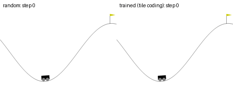

**MountainCarContinuous-v0** (random vs SAC with energy shaping, 30 training episodes):

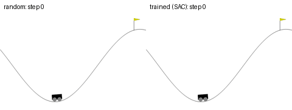

**Every method that solved it**, same start state, greedy policy (Q-learning, 55% greedy success,
happens to time out on this start; the other panels reach the flag):

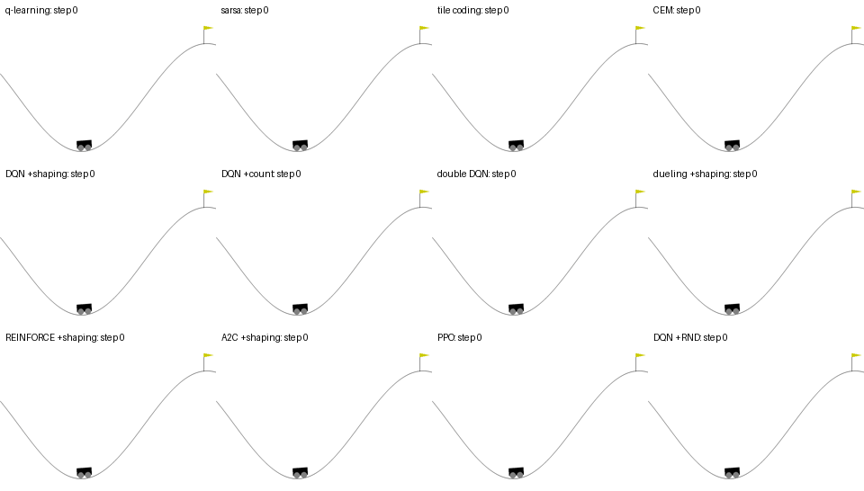

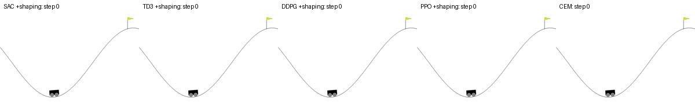

**How the policy is learnt**: the greedy action of tile coding over (position, velocity) every
4 episodes. It starts as noise (all ties), then the "push with the velocity" spiral grows out from
the flag (dashed line) as successes propagate back:

<p align="center">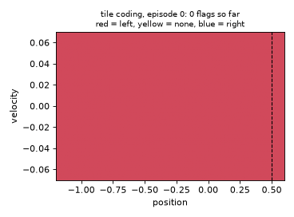</p>

All five animations are rebuilt by `python scripts/make_gifs.py` (after `mountaincar-compare --suite all`).

MountainCar gives **-1 per step until the flag**: every failed episode scores exactly -200, so a
learner gets no hint until it reaches the flag once. The engine is weaker than gravity, so the car
must rock back and forth to get there. This is the classic exploration problem, and it is small
enough that every method trains on one CPU thread in seconds to a few minutes.

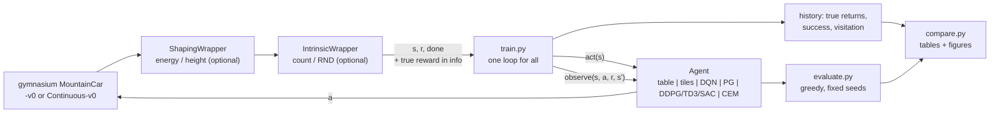

| method | `--algo` | how it works, in one line | code |
|---|---|---|---|
| Q-learning | `q-learning` | table over a 16 x 16 grid, target `r + gamma max Q(s')`; zero init is optimistic, so greedy = exploring | `algorithms/tabular.py` |
| SARSA | `sarsa` | same table, target uses the action actually taken next (on-policy) | `algorithms/tabular.py` |
| tile coding | `tile-coding` (`--td-target sarsa\|q`) | 8 offset 8 x 8 tilings, linear Q, semi-gradient update of the 8 active weights | `algorithms/tile_coding.py` |
| DQN | `dqn` | MLP Q-network, replay buffer, target network, epsilon-greedy | `algorithms/dqn.py` |
| Double DQN | `double-dqn` | online net picks `a'`, target net scores it (less over-estimation) | `algorithms/dqn.py` |
| Dueling DQN | `dueling-dqn` | `Q = V(s) + A(s,a) - mean A` head | `networks.py` |
| + prioritized replay, n-step | `--prioritized`, `--n-step 3` | sum-tree sampling by TD error; n-step returns | `replay.py` |
| REINFORCE | `reinforce` | Monte Carlo return minus a learned baseline, one update per episode | `algorithms/policy_gradient.py` |
| A2C | `a2c` | 16-step bootstrapped advantage, actor + critic | `algorithms/policy_gradient.py` |
| PPO | `ppo` (discrete or `--continuous`) | GAE advantages, 10 epochs of the clipped ratio objective per 2048-step rollout | `algorithms/policy_gradient.py` |
| DDPG | `ddpg --continuous` | deterministic actor following `dQ/da`, Gaussian action noise | `algorithms/actor_critic.py` |
| TD3 | `td3 --continuous` | twin critics (min), target smoothing, delayed actor | `algorithms/actor_critic.py` |
| SAC | `sac --continuous` | tanh-Gaussian actor, max reward + entropy, auto-tuned temperature | `algorithms/actor_critic.py` |
| cross-entropy method | `cem` | sample 20 linear policies, refit a Gaussian to the best 4; no gradients | `algorithms/cem.py` |

| exploration aid | flag | what it adds |
|---|---|---|
| reward shaping (**clearly marked "+shaping"**) | `--shaping energy\|height` | `gamma Phi(s') - Phi(s)` with Phi = mechanical energy or height (potential-based, optimal policy unchanged) |
| count bonus | `--intrinsic count` | `0.1 / sqrt(N(cell))` |
| Random Network Distillation | `--intrinsic rnd` | prediction error against a frozen random net |
| epsilon schedules | `--eps-schedule const\|linear\|exp` | how epsilon-greedy decays |

Every update is written out with its equations and the reason it works (or fails) here in
[docs/architecture.md](docs/architecture.md).

## Quick start

```bash
git clone https://github.com/benisalla/mountaincar-rl && cd mountaincar-rl
uv venv .venv && VIRTUAL_ENV=.venv uv pip install -e ".[dev]"     # or: pip install -e ".[dev]"
source .venv/bin/activate

mountaincar-train --algo tile-coding                     # first flag after ~25 episodes, a few seconds
mountaincar-train --algo dqn --shaping energy            # DQN needs help: try it without --shaping
mountaincar-train --algo sac --continuous --shaping energy
mountaincar-eval checkpoints/tile-coding_disc --episodes 100
mountaincar-play checkpoints/tile-coding_disc --gif car.gif
mountaincar-compare --suite tabular                      # table + figures in assets/
```

Unset flags take each method's recommended small settings (`config.RECOMMENDED`); every field of
`TrainConfig` is a flag. Rendering is headless (pygame with `SDL_VIDEODRIVER=dummy`).

## Examples

[`examples/`](examples/README.md) holds six numbered scripts that use the package from Python,
each one command on a CPU: look at the environment (01), tabular Q-learning and SARSA (02), tile
coding with a GIF (03), Double DQN with and without shaping (04), REINFORCE / A2C / PPO / CEM (05)
and the continuous car with SAC, TD3, DDPG, PPO and CEM (06).

```bash
python examples/01_explore_the_environment.py && python examples/03_tile_coding.py
```

## Results

**Short CPU runs, one seed (0), on a shared and busy 8-core machine, one thread per run. They show
which methods learn under a small budget; they are not benchmarks.** "first success" is the first
training episode that reached the flag; "eval" is the greedy policy on 20 fixed start states
(seeds 1000-1019) with the true reward. Wall times depend on the machine load at the time (the
same tabular run took 14 s on a quiet machine and 3 min on a loaded one). All runs:
`mountaincar-compare --suite <name>`; raw numbers in `assets/<suite>_results.json`.

### Tabular, tile coding and CEM (MountainCar-v0, no shaping)

| run | episodes | first success (episode) | train success (last 50) | eval success | eval return | eval steps | time |
|---|---|---|---|---|---|---|---|
| `q-learning` | 3000 | 215 | 70% | **55%** | -161.8 | 162 | 14 s |
| `sarsa` | 3000 | 57 | 94% | **90%** | -158.0 | 158 | 11 s |
| `tile-coding (sarsa)` | 300 | 23 | 100% | **95%** | -136.8 | 137 | 4 s |
| `tile-coding (q)` | 300 | 27 | 100% | **100%** | -112.6 | 113 | 6 s |
| `cem` | 300 | 21 | 100% | **100%** | -113.2 | 113 | 2 s |

No exploration aid at all, and all five learn: the zero-initialised table and tile weights are
optimistic, so the greedy agent tries every untried action. Tile coding reaches 95-100% in 300
episodes where the plain grid is still at 55-90% after 3000, because neighbouring states share
tiles and one update teaches the whole neighbourhood. CEM is the humbling baseline: a
9-weight linear policy found by black-box search in 21 episodes, because "push in the direction of
the velocity" is a linear policy.

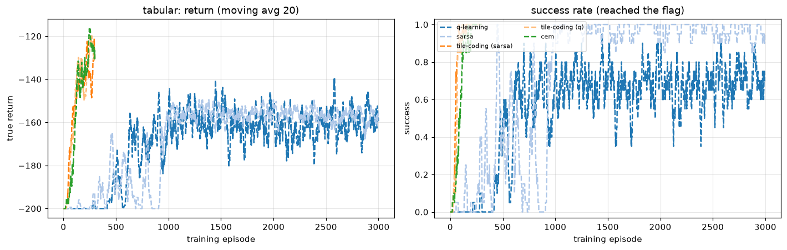
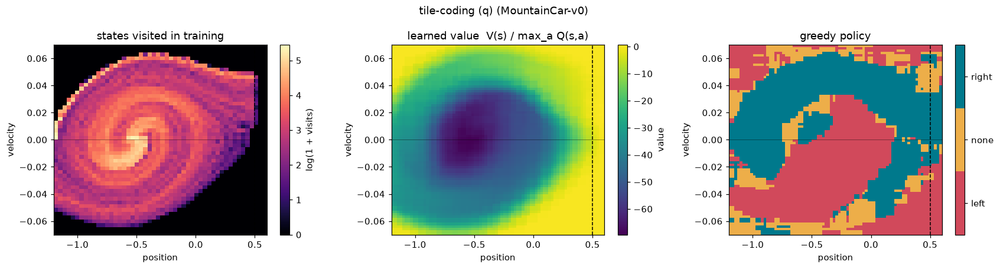

The maps above (left to right): where the car went during training, the learned
`max_a Q(s,a)`, and the greedy action. The spiral is the rocking motion; the policy splits the
plane into "push left when moving left, push right when moving right".

### Neural methods, with and without energy shaping (MountainCar-v0)

| run | episodes | first success (episode) | train success (last 50) | eval success | eval return | eval steps | time |
|---|---|---|---|---|---|---|---|
| `dqn` | 300 | never | 0% | **0%** | -200.0 | 200 | 197 s |
| `dqn +shaping` | 300 | 65 | 100% | **95%** | -159.8 | 160 | 204 s |
| `double-dqn` | 300 | 165 | 4% | **80%** | -141.8 | 142 | 196 s |
| `double-dqn +shaping` | 300 | 65 | 100% | **100%** | -123.3 | 123 | 143 s |
| `dueling-dqn` | 300 | never | 0% | **0%** | -200.0 | 200 | 274 s |
| `dueling-dqn +shaping` | 300 | 65 | 100% | **100%** | -138.3 | 138 | 149 s |
| `reinforce` | 500 | never | 0% | **0%** | -200.0 | 200 | 45 s |
| `reinforce +shaping` | 500 | 238 | 24% | **95%** | -129.2 | 129 | 34 s |
| `a2c` | 500 | never | 0% | **0%** | -200.0 | 200 | 83 s |
| `a2c +shaping` | 500 | 371 | 100% | **100%** | -141.1 | 141 | 80 s |
| `ppo` | 500 | 198 | 100% | **100%** | -142.2 | 142 | 76 s |
| `ppo +shaping` | 500 | 135 | 100% | **100%** | -140.0 | 140 | 203 s |

This is the lesson of the repo. **On the raw reward DQN, Dueling DQN, REINFORCE and A2C never
reach the flag in their budget**: a neural network is not optimistic, epsilon-greedy dithering
does not build energy, and with every return at -200 there is nothing to learn. Double DQN
(80%) and PPO (100%) got lucky once (first success at episodes 165 and 198) and then learnt fast;
with another seed they may not. **With potential-based energy shaping, every method solves it**,
and the DQN family finds the flag 3x sooner (episode 65). REINFORCE is the special case:
shaping telescopes inside a Monte Carlo return into a baseline (see
[architecture.md](docs/architecture.md#policy-gradient-reinforce-a2c-ppo-algorithmspolicy_gradientpy)),
so it only works with a shorter horizon (`gamma = 0.9`, its recommended setting).

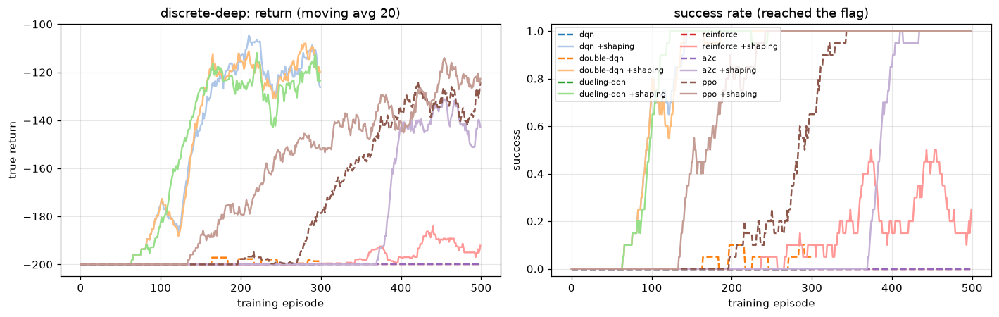
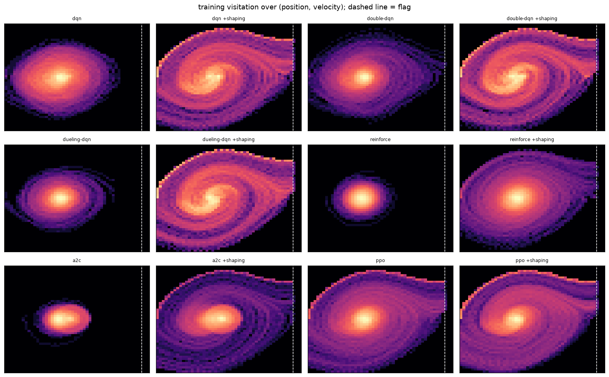

The visitation plots show it directly: the failing runs stay in a blob around the valley, the
working ones trace spirals out to the flag (dashed line).

### Exploration aids on DQN (MountainCar-v0, 300 episodes)

| run | episodes | first success (episode) | train success (last 50) | eval success | eval return | eval steps | time |
|---|---|---|---|---|---|---|---|
| `dqn eps exp` | 300 | 250 | 0% | **0%** | -200.0 | 200 | 77 s |
| `dqn +count` | 300 | 59 | 100% | **100%** | -119.5 | 119 | 62 s |
| `dqn +rnd` | 300 | 250 | 100% | **100%** | -152.8 | 153 | 84 s |
| `dqn +per +n3` | 300 | 98 | 46% | **0%** | -200.0 | 200 | 104 s |
| `dqn +height shaping` | 300 | 59 | 28% | **90%** | -149.1 | 149 | 73 s |
| `q-learning +energy shaping` | 3000 | 38 | 100% | **100%** | -132.3 | 132 | 16 s |

Plain DQN (linear epsilon) is 0% and DQN + energy shaping 95% (table above). Novelty bonuses that
are *not* domain knowledge work too: the **count bonus solves it (100%, first success at episode
59)** and RND as well (100%, later). Height shaping helps less than energy shaping (it ignores
speed). An exponential epsilon schedule alone does not help, and prioritized replay + 3-step
returns found the flag (episode 98) but its greedy policy had not converged by the end of the
budget. Energy shaping also turns tabular Q-learning from 55% into 100%.

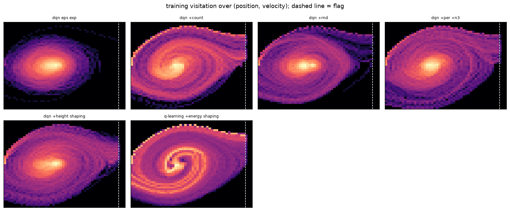

### Continuous control (MountainCarContinuous-v0, 999-step episodes)

| run | episodes | first success (episode) | train success (last 50) | eval success | eval return | eval steps | time |
|---|---|---|---|---|---|---|---|
| `ppo` | 60 | never | 0% | **0%** | -0.0 | 999 | 59 s |
| `ppo +shaping` | 60 | 3 | 100% | **100%** | 94.7 | 150 | 20 s |
| `ddpg` | 30 | never | 0% | **0%** | -0.0 | 999 | 105 s |
| `ddpg +shaping` | 30 | 6 | 83% | **100%** | 90.2 | 101 | 6 s |
| `td3` | 30 | never | 0% | **0%** | -0.3 | 999 | 73 s |
| `td3 +shaping` | 30 | 6 | 83% | **100%** | 93.1 | 85 | 11 s |
| `sac` | 30 | never | 0% | **0%** | -0.0 | 999 | 120 s |
| `sac +shaping` | 30 | 6 | 83% | **100%** | 92.3 | 109 | 23 s |
| `cem` | 100 | 7 | 92% | **100%** | 96.9 | 290 | 1 s |
| `cem +shaping` | 100 | 7 | 92% | **100%** | 95.3 | 404 | 1 s |

The trap of the continuous version, reproduced cleanly: **without shaping PPO, DDPG, TD3 and SAC
all converge to "do nothing"** (return about 0, 999 steps), because before any success the only
signal is the action cost `-0.1 a^2`. With energy shaping all four solve it in a few episodes
(return 90-95). CEM with a 3-weight `tanh` policy solves it without any help.

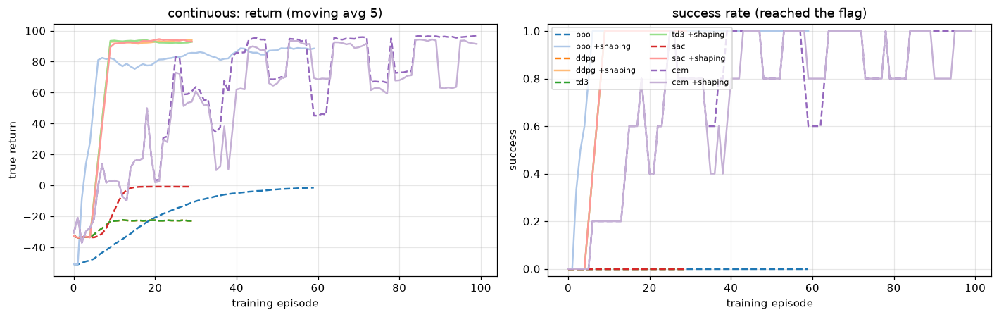

## Train for real: Kaggle / Colab notebook

[`notebooks/train_colab_kaggle.ipynb`](notebooks/train_colab_kaggle.ipynb) is generated by
`notebooks/build_notebook.py`: it installs the package from GitHub, explains sparse rewards and
exploration, discretization vs tile coding vs neural nets, and each algorithm's update step by step
with the exact code from `src/` (copied in at build time), trains each family, and ends with the
full comparison (`FULL = True`: three seeds, twice the budget).

## Repository layout

```
src/mountaincar_rl/
  config.py        TrainConfig (every CLI flag), per-method recommended settings
  envs.py          make_env, ShapingWrapper, IntrinsicWrapper (count, RND), normalisation, grids
  algorithms/
    base.py        the Agent interface + epsilon schedules
    tabular.py     Q-learning, SARSA
    tile_coding.py TileCoder + semi-gradient SARSA / Q
    dqn.py         DQN, Double DQN, Dueling DQN (+ PER, n-step)
    policy_gradient.py  REINFORCE, A2C, PPO (Categorical or Gaussian)
    actor_critic.py     DDPG, TD3, SAC
    cem.py         cross-entropy method
  networks.py      MLPs, dueling head
  replay.py        uniform / prioritized (sum tree) replay, n-step accumulator
  train.py         the shared loop, checkpoints, mountaincar-train
  evaluate.py      greedy evaluation, mountaincar-eval
  play.py          episodes + GIF, mountaincar-play
  metrics.py       History, first success, tables
  viz.py           curves, visitation / value / policy maps, GIFs
  compare.py       run suites, mountaincar-compare
scripts/make_gifs.py  before/after GIFs, solved-methods grid, policy-map animation
tests/             51 tests, about a minute on one CPU
examples/          six numbered scripts
docs/              architecture, environment, training, evaluation, testing
notebooks/         build_notebook.py -> train_colab_kaggle.ipynb
assets/            figures and tables from the runs above
```

## Documentation

- [docs/architecture.md](docs/architecture.md): every method's update, equations and why it works or fails here
- [docs/environment.md](docs/environment.md): the two environments, success, shaping and bonuses
- [docs/training.md](docs/training.md): the loop, CLI, budgets and recommended settings
- [docs/evaluation.md](docs/evaluation.md): the evaluation protocol and the runs behind the tables
- [docs/testing.md](docs/testing.md): what the tests check
- [examples/](examples/README.md): the package from Python, step by step

## Legacy notebooks

None: this repository was written fresh, there is no earlier notebook for MountainCar.

## References

Sutton & Barto 2018 (tile coding, semi-gradient SARSA, ch. 10) · Moore 1990 (MountainCar) ·
Mnih et al. 2015 (DQN) · van Hasselt et al. 2016 (Double DQN) · Wang et al. 2016 (Dueling) ·
Schaul et al. 2016 (prioritized replay) · Williams 1992 (REINFORCE) · Mnih et al. 2016 (A2C) ·
Schulman et al. 2016, 2017 (GAE, PPO) · Lillicrap et al. 2016 (DDPG) · Fujimoto et al. 2018 (TD3) ·
Haarnoja et al. 2018 (SAC) · Ng, Harada & Russell 1999 (potential-based shaping) · Burda et al.
2019 (RND) · Rubinstein 1999 (cross-entropy method).

## License

MIT
