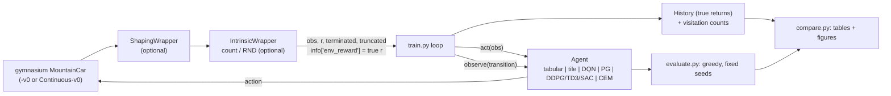

# Architecture: every method, its update, and why it works (or does not) on MountainCar

The code base has one idea: **every method is an `Agent` with the same five methods**
(`act`, `observe`, `start_episode`, `end_episode`, `policy_grid` / `value_grid`), and one
training loop (`train.py`) runs all of them. Exploration aids are environment wrappers
(`envs.py`), so the algorithms never know whether the reward was shaped.



## The problem in one paragraph

State `s = (position, velocity)`, position in [-1.2, 0.6], velocity in [-0.07, 0.07]. The track
is `y = sin(3x)`, the car starts at rest in the valley (x in [-0.6, -0.4]) and the flag is at
x = 0.5. Dynamics: `v' = v + 0.001 a - 0.0025 cos(3x)`, `x' = x + v'`. The engine (0.001) is
weaker than gravity on the slope (up to 0.0025), so driving right fails: the car must swing
left first to gain energy. **Reward:** `-1` per step in `MountainCar-v0` (200-step limit, actions
left / none / right); `-0.1 a^2` per step and `+100` at the flag in `MountainCarContinuous-v0`
(999-step limit, force in [-1, 1]). In both, nothing distinguishes a good attempt from a bad one
until the flag is reached once. That is the **exploration problem**.

## Three ways to represent the state

| representation | used by | Q or policy | generalisation |
|---|---|---|---|
| grid of `bins x bins` cells | `q-learning`, `sarsa` | a table `Q[i, j, a]` | none: each cell learns alone |
| 8 offset tilings of 8 x 8 tiles | `tile-coding` | `Q(s,a) = w_a . x(s)`, x binary with 8 ones | local: neighbours share tiles |
| MLP on normalised `(x, v)` in [-1, 1]^2 | DQN, PG, DDPG/TD3/SAC | `Q_theta(s, .)`, `pi_theta(a|s)` | global and smooth, but not controlled |

## Tabular Q-learning and SARSA (`algorithms/tabular.py`)

```
Q-learning:  Q(s,a) <- Q(s,a) + alpha [ r + gamma max_b Q(s',b) - Q(s,a) ]        (off-policy)
SARSA:       Q(s,a) <- Q(s,a) + alpha [ r + gamma Q(s',a')    - Q(s,a) ]          (on-policy)
terminal (flag): target = r
```

In code, `TabularAgent.observe` computes `target` and moves one entry. SARSA picks `a'` inside
the update and stores it in `_next_action`, so the next `act` returns the action that was used in
the target (that is what makes it on-policy).

**Why optimistic initialisation is the exploration.** `Q = 0` everywhere, and every real return
is negative. An action that has been tried gets a lower value than the untried ones, so a purely
greedy agent (epsilon = 0) cycles through untried actions: it explores systematically. Ties are
broken at random, which matters when a whole row is still 0.

## Tile coding (`algorithms/tile_coding.py`)

`TileCoder.active(s)` returns one tile index per tiling; tiling k is shifted by
`(1, 3) * k / tilings` of a tile (asymmetric offsets, Sutton & Barto 9.5.4).

```
Q(s, a) = sum_{i in active(s)} w[a, i]
w[a, active(s)] += (alpha / tilings) * (target - Q(s, a))     # gradient of a linear Q is x(s)
target = r + gamma Q(s', a')   (sarsa)   or   r + gamma max_b Q(s', b)   (q)
```

Dividing alpha by the number of tilings makes `alpha` the fraction of the error corrected at
`s` in one step. It is "semi-gradient" because the target also depends on `w` but is not
differentiated. Generalisation makes one success propagate to the whole neighbourhood, which is
why it solves the task in about a hundred episodes where the plain grid needs thousands.

## DQN, Double DQN, Dueling DQN (`algorithms/dqn.py`, `networks.py`, `replay.py`)

```
y      = r + gamma^n (1 - done) max_a' Q_target(s', a')                       DQN
y      = r + gamma^n (1 - done) Q_target(s', argmax_a' Q(s', a'))             Double DQN
Q(s,a) = V(s) + A(s,a) - mean_b A(s,b)                                         Dueling network
loss   = mean_i w_i Huber(Q(s_i, a_i) - y_i)
```

* replay buffer of 50 000 transitions, minibatch 64, one Adam step per environment step after
  1 000 warm-up steps; the target net is copied every 500 steps;
* `--prioritized`: sample with probability `p_i^0.6 / sum p^0.6`, `p_i = |TD error| + 1e-3`, with
  importance weights `(N P(i))^-beta` (beta 0.4 -> 1), stored in a sum tree (`SumTree`);
* `--n-step n`: `NStepAccumulator` stores `(s_t, a_t, sum_k gamma^k r_t+k, s_t+n, gamma^n)`;
* exploration is epsilon-greedy with `--eps-schedule const|linear|exp`.

`done` is 1 only when the flag is reached (`terminated`); a time-out (`truncated`) still
bootstraps, because the state after 200 steps is not worthless, the clock just stopped.

**Why it fails on the raw reward:** the Q-net is not optimistic (its outputs start near 0 but
the regression quickly pulls every value down to about -1/(1-gamma) uniformly), and random
dithering with epsilon almost never builds enough energy in 200 steps. With no success in the
buffer the targets contain no information about the flag.

## Policy gradient: REINFORCE, A2C, PPO (`algorithms/policy_gradient.py`)

The policy is Categorical (3 logits) or Gaussian `N(mu(s), exp(log_std))` for the force; a
separate MLP is the critic `V(s)`.

```
REINFORCE (per episode):   A_t = G_t - V(s_t),          G_t = sum_k gamma^k r_t+k
A2C (every 16 steps):      A_t = n-step return bootstrapped with V(s_t+n) - V(s_t)
PPO (every 2048 steps):    GAE  A_t = delta_t + gamma lambda A_t+1,  delta_t = r_t + gamma V(s'_t) - V(s_t)
                           10 epochs of minibatch 64 on  min(rho A, clip(rho, 0.8, 1.2) A)
loss = -policy objective + 0.5 (V - target)^2 - 0.01 entropy
```

`_advantages` handles both terminations correctly: `(1 - terminated)` cuts the bootstrap at the
flag, `(1 - end)` stops the GAE recursion at any episode boundary (flag or time-out), and the
value of the stored `next_obs` bootstraps a time-out.

**Why they fail on the raw reward:** if every episode returns exactly -200, `G_t - V(s_t)` is
noise around 0 and the policy has no direction. In the continuous task the only signal before the
flag is `-0.1 a^2`, whose gradient says "push less": the policy collapses to doing nothing.

**Potential-based shaping does almost nothing for Monte Carlo returns.** Summed along an
episode the shaping terms telescope:

```
G'_t = sum_k gamma^k (r_t+k + gamma Phi(s_t+k+1) - Phi(s_t+k)) = G_t - Phi(s_t) + gamma^(T-t) Phi(s_T)
```

`-Phi(s_t)` does not depend on the action, so for REINFORCE it is just another baseline; the only
new signal is the discounted energy at the end of the episode. A2C and PPO bootstrap with a critic
after one or a few steps, so they see the per-step shaping term `gamma Phi(s') - Phi(s)` directly,
and that is where shaping helps. REINFORCE uses `gamma = 0.9` here (see `config.RECOMMENDED`): with
the default 0.99 it learnt nothing in 500 episodes with or without shaping (`G_t` is then dominated
by the -1 per step summed over up to 200 steps, which depends on the time step rather than on the
state, so the baseline cannot remove it).

## DDPG, TD3, SAC (`algorithms/actor_critic.py`)

```
DDPG:  y = r + gamma (1-d) Q'(s', mu'(s'))                 actor: max Q(s, mu(s))
TD3:   y = r + gamma (1-d) min_i Q_i'(s', clip(mu'(s') + eps))   actor every 2 critic steps
SAC:   y = r + gamma (1-d) [min_i Q_i'(s', a') - alpha log pi(a'|s')],  a' ~ pi(.|s')
       actor: min alpha log pi(a|s) - min_i Q_i(s, a);   alpha: keep entropy near -1
targets: theta' <- 0.005 theta + 0.995 theta'
```

The SAC actor is a tanh-squashed Gaussian; its log-probability includes the change of variables
`- sum log(1 - tanh(u)^2)` (`GaussianActor.forward`). The first `warmup_steps` actions are uniform
random, which is the main source of the first successes.

## Cross-entropy method (`algorithms/cem.py`)

A linear policy on `phi(s) = (x, v, 1)` (normalised): `argmax(W phi)` (9 weights) or
`tanh(w . phi)` (3 weights). Sample 20 weight vectors from `N(mean, sigma^2)`, run one episode
with each, refit `mean, sigma` to the best 20% (+ a decaying noise floor). No gradients at all.
It works because "push in the direction of the velocity" is a linear policy, and a random linear
policy is close to it with decent probability. It is the baseline the other methods must beat.

## Exploration aids (`envs.py`)

| flag | what is added to the learning reward | changes the optimal policy? |
|---|---|---|
| `--shaping energy` | `gamma Phi(s') - Phi(s)`, `Phi = 10 * energy(s)` | no (potential-based, Ng et al. 1999) |
| `--shaping height` | same with `Phi = 10 * sin(3x)` | no, but a weaker hint (speed is ignored) |
| `--intrinsic count` | `0.1 / sqrt(N(cell))` on a 40 x 40 grid | yes, transiently (the bonus decays) |
| `--intrinsic rnd` | `0.1 * ||f(s) - f_rand(s)||^2 / running mean` | yes, transiently |
| `--eps-schedule` | nothing: changes how epsilon decays | - |

Energy: `E(s) = (0.0025/3 sin(3x) + v^2 / 2) / (0.0025/3 sin(1.5))`, i.e. 1 when standing at the
flag. Shaping uses knowledge of the physics: **results with shaping are marked "+shaping"
everywhere and are not a fair comparison with the unshaped methods**; they show what a dense
signal does to each method.
